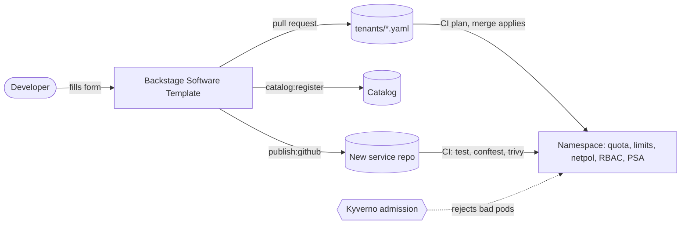

# Golden Path Platform - Self-Service Templates with Guardrails

A developer fills in one Backstage form and gets: a GitHub repo with a production-ready Python service, CI/CD, a Helm chart,
catalog ownership metadata, security scanning, and a **guard-railed Kubernetes namespace** requested through a reviewed pull request.
The cluster enforces the same standards again at admission time, so the paved road is also the only road.

**Stack:** Backstage - Kubernetes - Helm - Terraform - GitHub Actions - OPA (Conftest) - Kyverno

| Submission item | Link |
|---|---|
| Live deployment URL | `<ADD AFTER DEPLOYING - see docs/deployment.md>` |
| GitHub repository | `<ADD>` |

## Architecture



Full diagram and the five guardrail layers: [docs/architecture.md](docs/architecture.md).

## What is in the box

| Path | Purpose |
|---|---|
| `backstage/templates/golden-path-service/` | Scaffolder template + skeleton (Flask app, Dockerfile, Helm chart, CI, OPA policy, `catalog-info.yaml`) |
| `terraform/modules/tenant` | Namespace with ResourceQuota (small/medium/large), LimitRange, default-deny NetworkPolicies, RBAC, Pod Security `restricted`, cross-field guardrails |
| `terraform/environments` | Reads `tenants/*.yaml`, one module per tenant |
| `terraform/platform` | Installs Kyverno + ingress-nginx |
| `policies/kyverno` | 6 admission policies (labels, no `latest`, resources, probes, registries, pod hardening) |
| `policies/opa` | The same rules as Rego for Conftest in CI, with unit tests |
| `.github/workflows` | Platform CI (tests, policies, Terraform validate, Checkov) and environment plan/apply |
| `tests/`, `policies/tests/` | pytest, Rego tests, Kyverno CLI tests |

## Prerequisites

Docker, kind, kubectl, helm, Terraform >= 1.6 (or OpenTofu), Python 3.12, conftest, kyverno CLI; Node 20/22 + yarn for Backstage;
a GitHub account and a fine-grained token (`repo`, `workflow`).

## Run it

```bash
# 1. Tests only - no cluster needed
pip install flask gunicorn pytest pyyaml
make test

# 2. Platform: kind + Kyverno + ingress-nginx + policies + example tenant (hello-dev)
make up

# 3. Prove it end to end (scaffold -> deploy -> violations rejected)
make smoke

# 4. Portal
./scripts/bootstrap-backstage.sh ../backstage-app     # then follow docs/deployment.md
```

Before using the template for real, replace `YOUR_GITHUB_ORG` in `template.yaml` (and `restrict-image-registries.yaml` if you want org-only images).

## Try the guardrails yourself

```bash
kubectl -n hello-dev apply -f examples/violations/latest-tag.yaml
# Error from server: admission webhook "validate.kyverno.svc-fail" denied the request: ... Using ':latest' is not allowed.
```

## Screenshots

Add yours per [docs/screenshots/README.md](docs/screenshots/README.md) and embed them here, e.g. ``.

## Testing evidence

[docs/testing-evidence/README.md](docs/testing-evidence/README.md): 11 pytest, 10 Rego, 18 Kyverno assertions, and 5 violation samples rejected by both engines, plus a list of what still needs to be run on your machine (`make smoke`, Helm, Terraform validate).
Design choices: [docs/design-choices.md](docs/design-choices.md). Failures handled: [docs/failure-handling.md](docs/failure-handling.md).

## Known limitations

- Terraform state is local by default; use `backend.tf.example` (S3 + DynamoDB) for team use.
- Backstage runs with guest auth and SQLite in the dev config; production needs GitHub OAuth and Postgres (`backstage/deploy/values.yaml`).
- Scaffolder steps are not transactional: if the PR step fails after the repo is created, the PR must be opened manually.
- Teams with the `edit` role can modify NetworkPolicies in their namespace; tighten with a Kyverno policy or a custom Role if needed.
- NetworkPolicy does not allow general internet egress; add an explicit egress policy per service that needs it.
- Kyverno image-registry policy allows all of `ghcr.io`; narrow it to your org.
- Single sample template (Python/Flask); additional golden paths (Node, Go) follow the same pattern.
- Helm lint/template, `terraform validate` and the kind smoke test could not be run where this was authored; CI runs them.

## Security

No secrets are committed. Tokens come from environment variables or Kubernetes Secrets; `.gitignore` excludes tfstate, tfvars and kubeconfigs.
