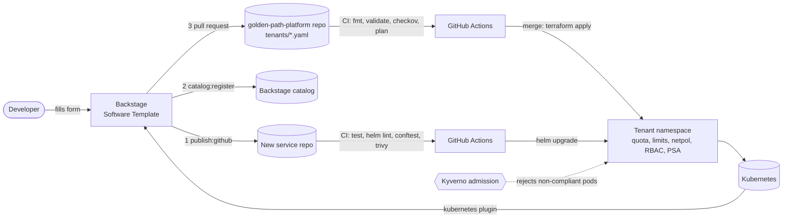

# Architecture



## Layers of guardrails (defence in depth)

| Layer | Where | Tool | Catches |
|---|---|---|---|
| 1. Form | Backstage template | JSON-schema patterns, enums | bad names, invalid env/tier, missing cost center |
| 2. Environment request | Platform repo PR | Terraform `validation` + `precondition`, Checkov | `large` in dev, prod without cost center, insecure TF |
| 3. Service CI | Generated repo | helm lint, **Conftest (OPA)**, Trivy | non-compliant manifests, vulnerable images |
| 4. Admission | Cluster | **Kyverno**, Pod Security Admission | anything that bypassed CI (kubectl, other pipelines) |
| 5. Blast radius | Namespace | ResourceQuota, LimitRange, NetworkPolicy, RBAC | noisy neighbours, lateral movement, over-broad access |

## Repository layout

```
backstage/templates/golden-path-service/   template.yaml + skeleton/ (app, chart, CI, policy) + tenant/
backstage/app-config.golden-path.yaml      config merged into the Backstage app
catalog/all.yaml                           seed Domain/System/Group/User entities
policies/kyverno|opa|tests                 admission policies, CI policies, unit tests
terraform/modules/tenant                   guard-railed namespace module
terraform/environments                     reads tenants/*.yaml -> one module per tenant
terraform/platform                         installs Kyverno + ingress-nginx
tenants/                                   one YAML per requested environment (GitOps source of truth)
scripts/                                   bootstrap, smoke test, local renderer
tests/                                     pytest for template + generated service
```
